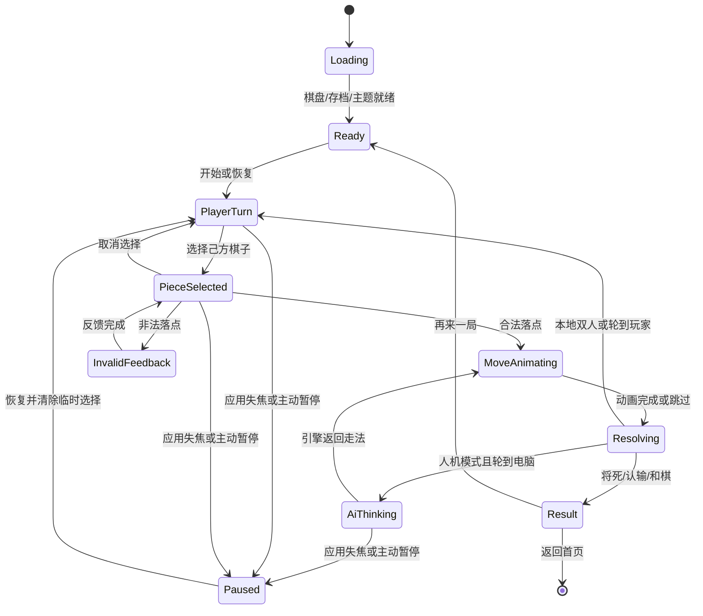

# 单机对局交互规格

状态：Draft for implementation

范围：人机对局、本地双人；移动端与桌面端

不包含：账号、联网匹配、排行榜、聊天、商业化

## 1. 产品体验目标

- 棋盘始终是第一交互面。常用动作一步可达，低频及破坏性动作收进菜单。
- 每个输入都必须得到可感知反馈，但不依赖单一颜色、动画或声音。
- 动画用于解释状态变化，不延迟规则判定，不阻塞暂停、退出或系统中断。
- 音效强调棋子的材质和局势层级；背景音乐保持可选、克制，不制造时间压力。
- 相同棋局状态在移动端和桌面端使用同一语义，仅改变布局和输入方式。

## 2. 当前实现基线

已有能力：基础选子/走子、合法点、本地双人轮转、人机引擎、走子与非法动画、悔棋、
自动保存骨架、12 个短音效资源。

进入完整产品交互前必须先解决：

- 当前返回被永久拦截且关闭按钮无动作，用户无法正常离开棋局。
- AI 计算期间棋盘错误回到 `idle`，玩家操作可能和 AI 回调竞态。
- “提示”当前会直接替用户走棋，而不是展示建议。
- 终局在棋子落位前弹窗，结果不是独立终态，并可能重复弹出。
- 业务落子依赖 Widget 动画 `onEnd`；页面切换、关闭动画或重建可能永久停在 `busy`。
- 悔棋缺少动画、AI 请求取消和终局守卫；继续上局、暂停、认输、复盘尚未实现。
- 棋钟未接入棋局，存档内双方耗时始终为零。
- 音效文件存在但没有播放依赖、控制器、设置或生命周期管理。

## 3. 对局状态模型

实现上应明确区分：

- `GamePhase`：规则与生命周期状态。
- `PresentationEffect`：一次性表现，例如将军、吃子、非法走子。
- `InputAvailability`：当前允许的命令集合。

动画完成回调不能是棋局继续运行的唯一条件。关闭动画、系统打断或 Widget
重建时，状态机仍必须可靠进入下一阶段。

## 4. 核心对局循环

### 4.1 进入对局

1. 页面立即显示稳定骨架和棋盘占位，禁止内容跳动。
2. 并行加载主题、最近存档、音频资源和 AI 引擎。
3. 有未结束棋局时提供“继续对局”和“重新开始”，不自动覆盖存档。
4. 准备完成后落入 `PlayerTurn`；新棋局播放一次开局音效，恢复棋局不播放。

### 4.2 选子

- 点击己方可行动棋子：显示选中环、合法落点，并播放轻触音。
- 点击另一枚己方棋子：直接切换选择，不需要先取消。
- 点击当前选中棋子或棋盘空白非落点：取消选择。
- 对方回合、AI 思考或动画期间不接受走子，但菜单、暂停和返回仍可用。
- 桌面端悬停只能预览可点击性，不能直接泄露合法落点。

### 4.3 走子与吃子

1. 触发后立即锁定棋盘输入，并在规则层确认合法性。
2. 合法走子沿直线移动到目标交点；移动棋子始终位于其他棋子上方。
3. 吃子时目标棋子先压暗并轻微缩小，移动棋子同时进入目标点。
4. 动画结束或被跳过后提交展示状态，更新最后一步标记与记谱。
5. 根据结果依次触发：普通走子、吃子、将军、将死；同一回合只播放最高优先级反馈。

### 4.4 非法走子

- 棋子在原交点水平摇动 4-6px 后回正，不朝非法目标跨格移动。
- 原交点保持选中，合法落点不消失，用户可立即重新选择。
- 播放低强度非法音效；移动端使用一次轻触觉反馈。
- 不弹 Toast，不显示阻断弹窗，不清空当前选择。

### 4.5 AI 回合

- 状态行显示“电脑思考中”，同时给出非循环、低干扰的呼吸指示。
- 引擎在 180ms 内返回时，至少保留一次状态切换帧，但不人为延迟超过 180ms。
- 超过 2 秒显示“仍在思考”；超过 8 秒允许取消并重试。
- 思考期间允许暂停、返回和打开设置；不允许悔棋、提示或操作棋盘。
- 应用进入后台时暂停计时与表现层；引擎结果可缓存，回到前台后再展示。

## 5. 命令交互

| 命令 | 可用条件 | 触发反馈 | 二次确认 |
| --- | --- | --- | --- |
| 悔棋 | 本地双人至少一步；人机模式完成一组双方走法 | 反向移动并恢复被吃棋子 | 否 |
| 提示 | 玩家回合、棋盘空闲 | 只高亮建议起点与终点 | 否 |
| 暂停 | 对局未结束 | 冻结计时、遮蔽棋盘内容 | 否 |
| 继续 | 已暂停 | 恢复到玩家回合或 AI 状态 | 否 |
| 新对局 | 任意非加载状态 | 打开模式与难度设置 | 有未结束棋局时确认 |
| 认输 | 对局未结束 | 进入结果流程 | 是 |
| 返回首页 | 任意状态 | 自动保存后返回 | 保存失败时提示 |
| 翻转棋盘 | 棋盘空闲 | 180 度重排棋子与坐标 | 否 |

禁用命令保留位置并显示原因。移动端使用长按或辅助文本说明；桌面端使用 Tooltip。

## 6. 动画规格

### 6.1 Motion tokens

| Token | 时长 | 曲线 | 用途 |
| --- | ---: | --- | --- |
| `instant` | 0ms | linear | Reduce Motion、系统恢复 |
| `press` | 80ms | easeOut | 按钮按压、棋子触下 |
| `select` | 120ms | easeOutCubic | 选中环、合法点 |
| `move` | 220ms | easeInOutCubic | 普通走子 |
| `capture` | 240ms | easeInOutCubic | 吃子组合 |
| `invalid` | 260ms | easeOutBack | 非法走子往返 |
| `panel` | 280ms | easeOutCubic | 菜单、设置、记谱面板 |
| `result` | 600ms | easeOutCubic | 将死到结果面板的过渡 |

走子距离超过五格时最多延长到 300ms，短距离不少于 180ms。动画过程中不使用弹跳、旋转或粒子爆炸。

### 6.2 事件时间线

| 场景 | 0ms | 80-140ms | 180-300ms | 完成 |
| --- | --- | --- | --- | --- |
| 选子 | 触下反馈 | 选中环建立 | 合法点稳定 | 等待输入 |
| 普通走子 | 锁定输入 | 棋子移动 | 落点音效、最后一步标记 | 下一回合 |
| 吃子 | 目标压暗 | 目标缩至 88% | 移动棋子落位、目标消失 | 局势反馈 |
| 非法 | 棋子偏移 | 到达最大偏移 | 返回原交点 | 保留选择 |
| 将军 | 落子完成 | 将帅交点脉冲一次 | 状态行显示“将军” | 下一回合 |
| 将死 | 落子完成 | 棋盘降噪 | 结果面板进入 | 提供复盘/再来一局 |
| 悔棋 | 锁定输入 | 棋子反向移动 | 被吃棋子恢复 | 恢复选择为空 |

### 6.3 减少动态效果

- 遵循系统 Reduce Motion；应用设置可单独设为“跟随系统 / 精简 / 完整”。
- 精简模式将移动改为 80ms 交叉替换，移除呼吸、缩放和位移动画。
- 所有动画为 0ms 时仍必须触发完成语义，不能卡在 `busy`。
- 不使用无限循环动画表达 AI 思考；使用静态状态文字加低频进度变化。

## 7. 响应式与输入差异

### 移动端

- 棋盘使用可用宽度，底部命令栏固定但不得遮挡棋盘。
- 点击目标至少 48dp；合法点的命中区域按交点计算，不受圆点视觉尺寸限制。
- 横向滑动不执行棋盘命令，避免与系统返回手势冲突。
- 触觉反馈只用于落子、非法、将军与结果，不随每个动画帧触发。

### 桌面端

- 棋盘保持 9:10，右侧检查器承载状态、记谱和设置。
- 支持鼠标点击和键盘方向键遍历交点；Enter 选中/落子，Escape 取消或关闭面板。
- 窗口缩小时先压缩检查器，再切换为移动端堆叠布局，棋盘不得溢出。
- 声音设置、主题设置使用菜单或检查器，不占用棋盘上的持久空间。

## 8. 生命周期与异常

- 失去焦点：单机默认暂停计时，不强制弹窗；重新聚焦显示“继续”。
- 音频中断：停止音乐、允许当前短音效自然结束；恢复时音乐渐入，不补播历史音效。
- 引擎错误：保留棋盘和存档，提供“重试思考”与“切换本地双人”。
- 存档错误：棋局仍可继续，状态区显示非阻断错误，并允许再次保存。
- 主题资源加载失败：回退经典木纹主题，不影响坐标或棋局状态。

## 9. 可访问性

- 棋子应提供“红方兵，五路七线”等语义标签；交点反馈同时使用形状和文字状态。
- 声音、触觉、颜色都不能是唯一反馈。
- 屏幕阅读器在走子后播报“红兵五进一；轮到黑方”，将军和结果使用更高优先级播报。
- 支持系统文字缩放；状态栏文字可换行，棋盘尺寸不能被状态文字挤压改变。
- 键盘焦点、选中棋子、建议走法和最后一步使用不同的视觉标记。

## 10. 实现边界

- `ChessBloc` 管理规则状态、回合、命令可用性和结果，不直接播放声音或创建 Overlay。
- `GamePresentationCoordinator` 将状态变化翻译为动画、音频和触觉事件，并负责去重。
- `MotionSpec` 集中管理时长、曲线与 Reduce Motion，不在 Widget 内散落常量。
- `GameAudioController` 消费语义化 cue，例如 `move`、`capture`、`check`，不依赖 Widget 名称。
- `GameSettingsRepository` 本地保存主题、音量、音乐、触觉和动态效果偏好。
- 一次性效果使用带唯一 ID 的事件，避免 Widget 重建重复播放。

## 11. 验收场景

1. 新局、恢复棋局、本地双人均可进入稳定的玩家回合。
2. 选择、切换选择、取消、合法走子、吃子和非法走子均有正确反馈。
3. 动画完整、精简和关闭三种模式不会改变棋局结果或卡住状态机。
4. AI 思考期间命令可用性符合规格，后台切换后不会多走或漏走一步。
5. 悔棋可正确恢复棋子、被吃棋子、回合、记谱、计时和引擎状态。
6. 同一走法只触发一个最高优先级音效，快速连点不会叠音。
7. 音频中断、来电、锁屏和窗口失焦后恢复正确。
8. 320px 移动宽度、常见手机、平板和 800x600 桌面窗口均无重叠或溢出。
9. 键盘与屏幕阅读器可以完成一盘本地双人棋局。
10. 退出或崩溃重启后，最后完成的走法与本地设置可恢复。

## 12. 落地顺序

### Phase 0：交互安全底座

- 建立 `GamePhase` 与命令权限矩阵。
- 将规则提交与动画完成解耦，引入唯一 `effectId`。
- 完成返回、自动保存、终局锁定和只出现一次的结果流程。
- 修复 AI 思考、提示和悔棋竞态。

完成标准：用户不会困在页面；快速点击、动画关闭、页面重建均不会多走、漏走或卡死。

### Phase 1：核心反馈

- 落地 Motion tokens、选子、普通走子、吃子、非法、将军、将死和悔棋动画。
- 接入短音效控制器、Cue 优先级、静音/音量设置和移动端触觉。
- 接入 Reduce Motion、读屏播报和键盘操作。

完成标准：所有核心走法在完整/精简/关闭动画以及开/关声音下均保持同样规则结果。

### Phase 2：完整单机循环

- 开局配置：AI 难度、执子、计时规则。
- AI thinking、失败重试、真正的提示高亮。
- 暂停、认输、新局、翻转棋盘、棋谱面板。
- 本地双人隐藏不适用的 AI 命令。

完成标准：人机与本地双人从开局到结果均无需开发入口或调试操作。

### Phase 3：恢复与棋钟

- 继续上局、存档顺序保证、坏记录降级。
- 单一 `GameClockBloc` 管理红黑双方、活动方、暂停原因和单调时间。
- 后台/前台、窗口失焦、音频中断和崩溃恢复。

完成标准：杀进程恢复后的局面和耗时误差不超过一秒，不会自动开始走钟。

### Phase 4：内容与发布打磨

- 复盘、历史棋局、记谱导出。
- 重新录制并规范化音效，完成许可证记录。
- 有合规音乐资产后再加入可选 BGM 和局势层，不以占位音乐上线。
- 三平台真机交互、性能、音频中断和无障碍验收。

完成标准：Android、iOS、macOS 的核心行为一致，平台差异只体现在输入和布局。
